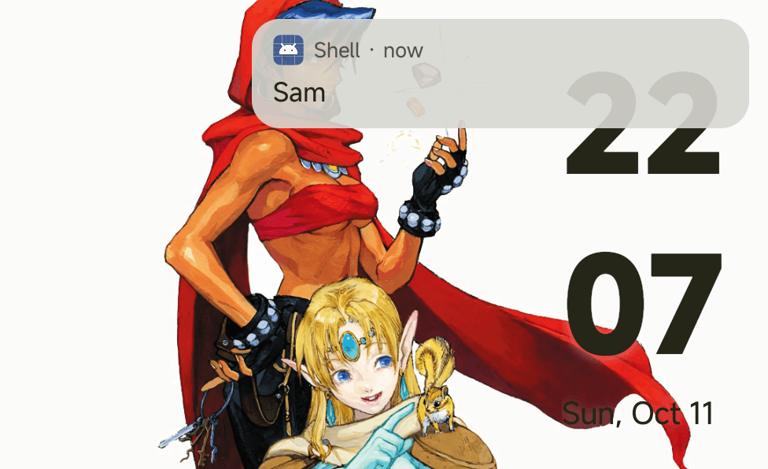
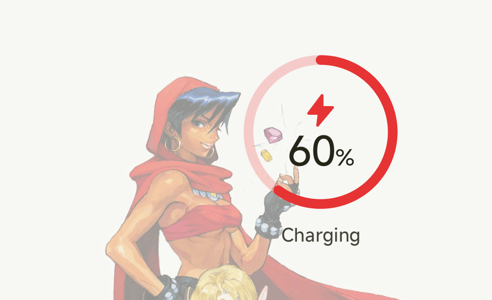
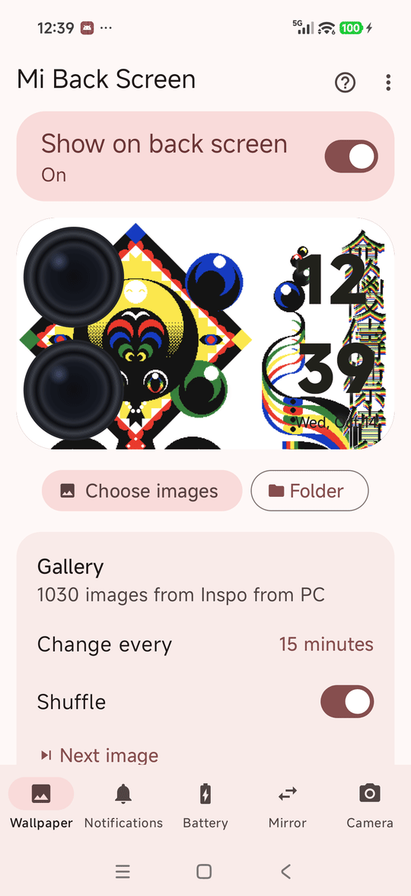
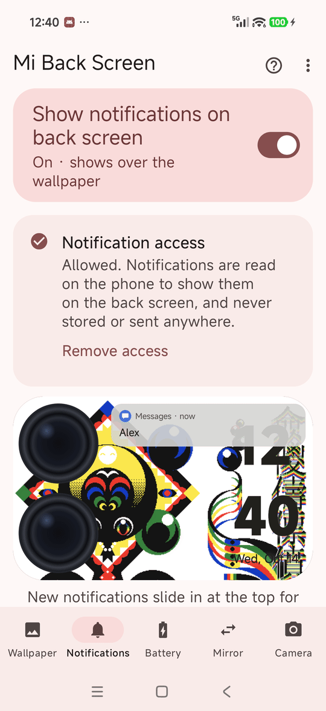
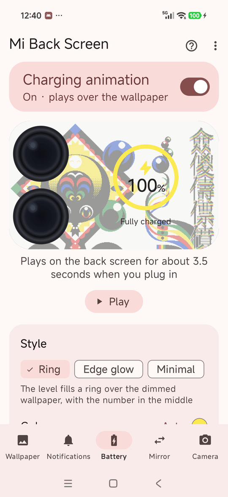
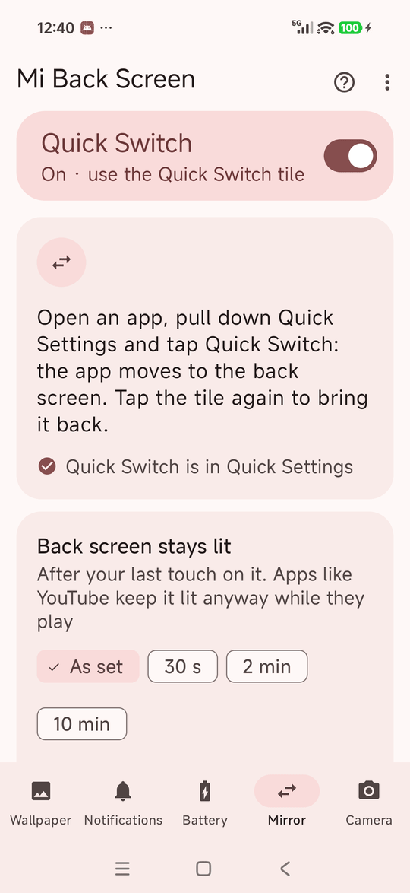
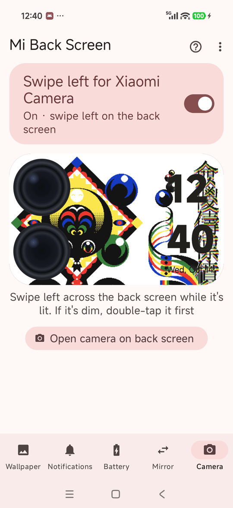

# Mi Back Screen

Your own images, animated GIFs, a clock and your notifications on the **Xiaomi 17 Pro Max** rear display. It can also move the app you're using to the back screen with one tap, and opens Xiaomi Camera there with a swipe.

**Website:** https://totallynotkasai.github.io/mi-back-screen/
**Download:** [latest APK](https://github.com/totallynotkasai/mi-back-screen/releases/latest/download/MiBackScreen.apk)

<p align="center">
  
  
  
</p>
<p align="center">
  
  
  
  
  
</p>

## Features

The app has five tabs, each with its own switch.

**Wallpaper**
- Images and looping GIFs from the photo picker, or a gallery (several images or a folder) that changes every 1 minute to 1 day, in order or shuffled.
- Fill, Fit, Stretch or actual size. Images that don't fit the screen's shape pan slowly while the back screen is lit, and **Skip short pans** keeps nearly-fitting ones still.
- An optional clock in five styles: drag it anywhere, pick any colour (or Auto to stand out from the image) and an optional background. It stays on time on the dimmed back screen.
- **Back screen display:** choose how long it stays lit (5 s to 5 min), keep it fully lit while unlocked, and light it again when you pick the phone up.
- A Quick Settings tile, a home-screen widget, and schedules (e.g. off overnight). It puts itself back after anything closes it, and after a restart once Shizuku is running.

**Notifications** — new ones slide in at the top showing just the app, the sender, or the message too. Pull down for the ones you haven't cleared. While locked it follows your lock screen's privacy setting.

**Battery** — plug in and the back screen plays a short charging animation with the level: **Ring**, **Edge glow** or **Minimal**, in a colour taken from the image or one you pick.

**Mirror** — **Quick Switch**, a Quick Settings tile, moves the app you're using to the back screen and back. It can show smaller or in portrait there, and Xiaomi's settings are put back when it leaves.

**Camera** — swipe left on the wallpaper and Xiaomi Camera opens on the back screen in its own back-screen mode, locked or unlocked. Cover the camera, use Xiaomi's back strip or tap the notification to close it.

No internet permission, no storage permission.

## Requirements

- Xiaomi 17 Pro Max on HyperOS (Android 13+)
- [Shizuku](https://shizuku.rikka.app/), running and authorised for Mi Back Screen

## Setup

1. Install and start Shizuku (wireless debugging or ADB).
2. Install the APK, open Mi Back Screen and tap **Allow access**.
3. Pick images (or a folder) and turn on **Show on back screen**.
4. If the app shows **Setup needed**, allow alarms, and in Settings → Apps → Mi Back Screen turn on **Autostart** and set **Battery saver** to **No restrictions**.
5. Turn on what you want on the other tabs. Shizuku grants Notification access in the same tap; without it, Android blocks that for sideloaded apps until you open App info → ⋮ → **Allow restricted settings**. For Quick Switch, also add its tile to Quick Settings.

## Good to know

- **A dimmed back screen takes no touches.** Double-tap it to light it, then swipe.
- **Lying on its back,** the back screen switches off, and after a while Xiaomi leaves it off when you pick the phone up. **Light up when you pick it up** (on by default) fixes that while the phone is unlocked.
- **Before uninstalling,** set **Stays lit for** to **As set**: it changes Xiaomi's own setting, which otherwise stays as you chose it.
- **The "Mi Back Screen is on" notification** is required by Android for background work. **Hide** on it turns it off for good; the app carries on as before.
- **Apps on the back screen:** a full-screen video may restart from the app's home page, the keyboard may open on the main screen, and some video apps show black on a second screen.
- **Xiaomi Camera** closes itself when the back screen isn't touched for a while, even while recording, so tap it now and then during a long video.
- **After a restart** Shizuku has to be started again (unless the phone is rooted). Mi Back Screen waits for it, then carries on.
- **Folder images stopped showing?** Choose the folder again (Wallpaper → Folder). Android can take back access to a folder, for example after it's moved or renamed.

## How it works

HyperOS doesn't let normal apps draw on the rear display, so Mi Back Screen uses Shizuku to run a fixed set of `am`, `input` and `cmd` commands (all in [`RearCommands.kt`](app/src/main/java/com/backscreen/wallpaper/core/RearCommands.kt)):

- **The wallpaper** is launched onto the rear display while unlocked. While locked, HyperOS only allows its own apps there, so it's opened on the main display and its task moved to the rear. Xiaomi's back screen app is restarted once so it doesn't take the screen back, and anything that closes the wallpaper is undone.
- **Notifications** come from a notification listener (granted with `cmd notification allow_listener`) and are shown inside the wallpaper window, so they appear at once.
- **Quick Switch** finds the app in front (`am stack list`) and moves its task to the back screen (`am display move-stack`), adjusting Xiaomi's timeout, density and rotation there and restoring each one afterwards.
- **The camera** opens with the same command Xiaomi's own back screen uses (`am start --display 1 …`), and closes with BACK.
- **The clock** keeps time on a dimmed back screen with an exact alarm each minute and a short draw wake lock, as the system's always-on displays do.

## Battery

Measured on a 17 Pro Max over an hour, locked, with the clock on the dimmed back screen: about **1.5 mAh** (0.02% of the battery). Panning costs about 20 mAh per hour the back screen is lit; a dimmed back screen shows its last frame and costs nothing extra. The charging animation runs for 3.5 seconds per plug-in.

## Privacy

Only the images or folder you pick are shared with the app, and chosen images are copied into its private storage (**Remove images** deletes them). Notifications are read only with Notification access and only while that tab is on; their text is shown on the back screen, kept in memory only while it's in your shade, and never stored or sent. Quick Switch reads only the names of apps with a launcher icon. There's no camera permission: Xiaomi Camera takes and saves the photos. Nothing leaves the phone.

## Building

Requires JDK 17 and the Android SDK.

```bash
./gradlew assembleDebug        # app/build/outputs/apk/debug/
./gradlew testDebugUnitTest    # unit tests
```

## Licence

[MIT](LICENSE). Not affiliated with Xiaomi.
